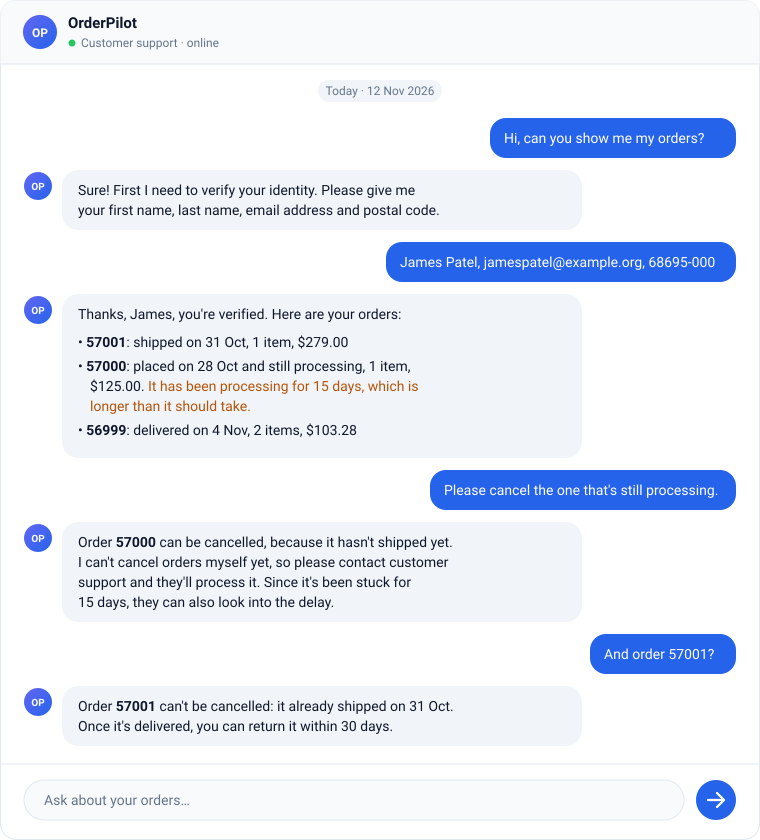
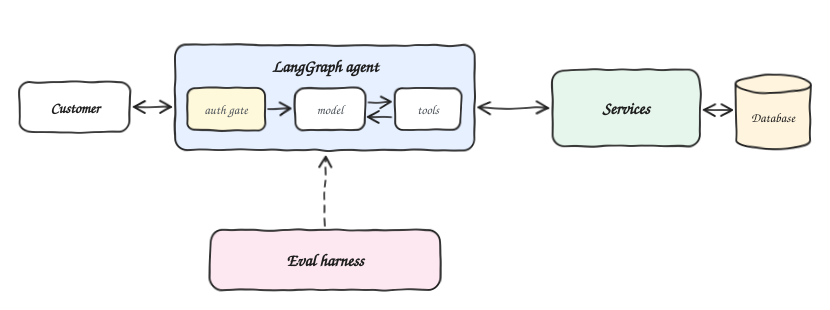

# OrderPilot - Eval-Driven AI Agent for E-commerce Customer Support

[](https://github.com/miladbehrooz/orderpilot-agent/actions/workflows/ci.yml)


[](LICENSE)


OrderPilot is a customer-support agent for an online clothing shop, built with LangChain and
LangGraph. It verifies the customer, looks up their orders, and tells them whether an order
can still be cancelled or returned, and why.

The agent is only half of the project. The other half is an **evaluation suite** that runs
the agent on hand-written customer questions, several times each, and grades every run on
the answer, the tools it called and the arguments it passed. Each change to the agent is
measured, not just tried by hand.

> 🚧 **Work in progress.** Milestone 1 (read-only support) is done and evaluated. Writes
> (cancellations, returns, support tickets) and a multi-agent version are next; see the
> [roadmap](#roadmap).

## Example

<p align="center">
  
</p>

<p align="center"><em>An example conversation with real data. The decisions and numbers come from the tools, not from the model.</em></p>

## Highlights

- **Business rules live in code, not in the prompt**
- **Authentication is enforced by the graph**
- **The model can't act as another customer**
- **Reproducible by design**
- **Errors are data**
- **Engineering hygiene**

## Architecture

<p align="center">
  
</p>

## Evaluation

Most agent demos show one good conversation. This one tests the agent the way it will fail
in practice: on the same questions many times, against known correct answers.

- **Hand-written cases** in [`evals/datasets/`](evals/datasets/), each tied to a scenario in
  [docs/scenarios.md](docs/scenarios.md): lookups, cancellation and return eligibility
  (inside or outside the 30-day window, not yet delivered, already returned, a single item of
  an order, …). Each case has a reference answer, key facts and the expected tool calls.
- **Metrics**, each answering one question:

  | Metric                 | Question                               | Grader                                    |
  | ---------------------- | -------------------------------------- | ----------------------------------------- |
  | `answer_correctness`   | Is the final answer right?             | LLM judge (OpenAI), against the reference |
  | `tool_correctness`     | Did the agent call the expected tools? | Code: openevals trajectory match          |
  | `argument_correctness` | With the expected arguments?           | Code: openevals trajectory match          |

- **Reliability, not luck:** every case runs *k* times. The report shows the pass rate,
  **pass^k** (every run passed) and **pass@k** (at least one passed) per scenario, plus
  flaky cases and latency.
- **Latest full run:** 14 cases × 3 runs on Claude Haiku 5.5, all passed. The sample is
  small and the LLM judge is not yet calibrated against human labels; both are on the roadmap.


## Quickstart

### Prerequisites
- [uv](https://docs.astral.sh/uv/) (it installs Python 3.11+ for you)
- An Anthropic or OpenAI API key for the agent
- Optional: a free [LangSmith](https://smith.langchain.com) account for tracing, Studio and evals

### 1. Install
```bash
git clone https://github.com/miladbehrooz/orderpilot-agent.git
cd orderpilot-agent
uv sync
cp sample.env .env        # then set ANTHROPIC_API_KEY (or switch LLM_PROVIDER to openai)
```

### 2. Get the data
OrderPilot uses **theLook E-commerce**, a synthetic clothing-shop dataset from Google's
Looker team. Download it from
[Kaggle](https://www.kaggle.com/datasets/mustafakeser4/looker-ecommerce-bigquery-dataset)
and put these five CSVs in `data/`:

`users.csv` · `orders.csv` · `order_items.csv` · `products.csv` · `distribution_centers.csv`

Or with the [Kaggle CLI](https://www.kaggle.com/docs/api) (needs a Kaggle API token):
```bash
uvx kaggle datasets download mustafakeser4/looker-ecommerce-bigquery-dataset -p data --unzip
```

### 3. Build the database
```bash
uv run python scripts/build_db.py --data-dir data --out ecommerce.sqlite --today 2026-11-12
```
The script cleans the data, shifts all dates so the latest event falls just before
`--today`, validates the result and writes `ecommerce.sqlite`. Keep `--today 2026-11-12`: the
eval cases are pinned to that date. Details are in [docs/data.md](docs/data.md).

### 4. Chat with the agent
In the terminal:
```bash
uv run python -m orderpilot
```

Or with a UI, through the LangGraph dev server:
```bash
uv run langgraph dev      # serves the `orderpilot` graph at http://127.0.0.1:2024
```

| UI                   | Use it for                                                            | How                                                                                                                                    |
| -------------------- | --------------------------------------------------------------------- | -------------------------------------------------------------------------------------------------------------------------------------- |
| **LangGraph Studio** | Debugging: graph view, state after each step, tool calls, time travel | Opens automatically. Needs `LANGSMITH_API_KEY` in `.env`.                                                                              |
| **Agent Chat UI**    | Chatting like a customer, demos                                       | Open [agentchat.vercel.app](https://agentchat.vercel.app), enter `http://127.0.0.1:2024` and graph ID `orderpilot`. No account needed. |

Safari blocks `https://` pages from reaching `localhost`. Use Chrome or Firefox, or run
`uv run langgraph dev --tunnel` and use the URL it prints.

**Demo customer.** The agent first asks who you are. Use the customer from the example
above (James Patel, `jamespatel@example.org`, postal code `68695-000`), or pick any
customer from the database:
```bash
sqlite3 ecommerce.sqlite "SELECT first_name, last_name, email, postal_code FROM users
  WHERE id IN (SELECT user_id FROM orders) ORDER BY random() LIMIT 3;"
```

**Tracing:** set `LANGSMITH_TRACING=true` and `LANGSMITH_API_KEY` in `.env` to send every run
(model calls, tool calls, tokens, latency) to LangSmith. Tests never trace.

## Running the evals

1. In `.env`, set `LANGSMITH_API_KEY`, `OPENAI_API_KEY` (for the judge) and `EVAL_JUDGE_MODEL`.
2. Upload the cases to LangSmith, then run an experiment:
   ```bash
   uv run python -m evals.sync --dataset m1
   EVAL_REPEATS=1 uv run python -m evals.run --split smoke   # quick check
   uv run python -m evals.run --split full                   # k = EVAL_REPEATS (default 3)
   ```

Each case is one question from an already-verified customer. The report is printed and its
overall numbers are attached to the experiment in LangSmith. `sync` and `run` refuse to
start if the database was built with a different `--today` than the dataset expects.

## Development

```bash
uv run pytest                                   # unit tests (no real LLM calls)
uv run ruff check . && uv run ruff format .     # lint and format
uv run mypy                                     # strict type check
uv run pre-commit install                       # run the checks on every commit
```

## Roadmap

**Done**
- [x] Read-only tools: verify customer, list orders, order details, cancellation and return eligibility
- [x] Single-agent LangGraph loop with an auth gate and lockout
- [x] Terminal chat, LangGraph Studio and Agent Chat UI; LangSmith tracing
- [x] Eval harness on LangSmith: `answer_correctness`, `tool_correctness`, `argument_correctness`; pass^k / pass@k report

**Next: evaluation**
- [ ] `reason_code` and `step_count` metrics
- [ ] Calibrate the LLM judge against human labels (agreement, κ) before it gates anything
- [ ] Safety gates: no data leaks, no internal IDs, auth before data, prompt-injection cases
- [ ] Groundedness: every claim in the answer backed by a tool output
- [ ] Multi-turn conversations with a simulated customer
- [ ] Smoke evals in CI on every pull request

**Next: agent**
- [ ] Milestone 2 write tools: `cancel_order`, `return_items`, `create_support_ticket`
- [ ] Confirmation before any write, and grading on the database state after each conversation
- [ ] Authentication on the LangGraph server before any deployment
- [ ] A supervisor/worker multi-agent version, compared with the single agent on the same evals

## Known limitations
- The data is synthetic and the eval set is still small (14 cases). Results are a signal,
  not a benchmark.
- The `answer_correctness` judge is not yet calibrated against human labels.
- The local LangGraph server has no authentication, so it is for local use only.


## License

[MIT](LICENSE)
